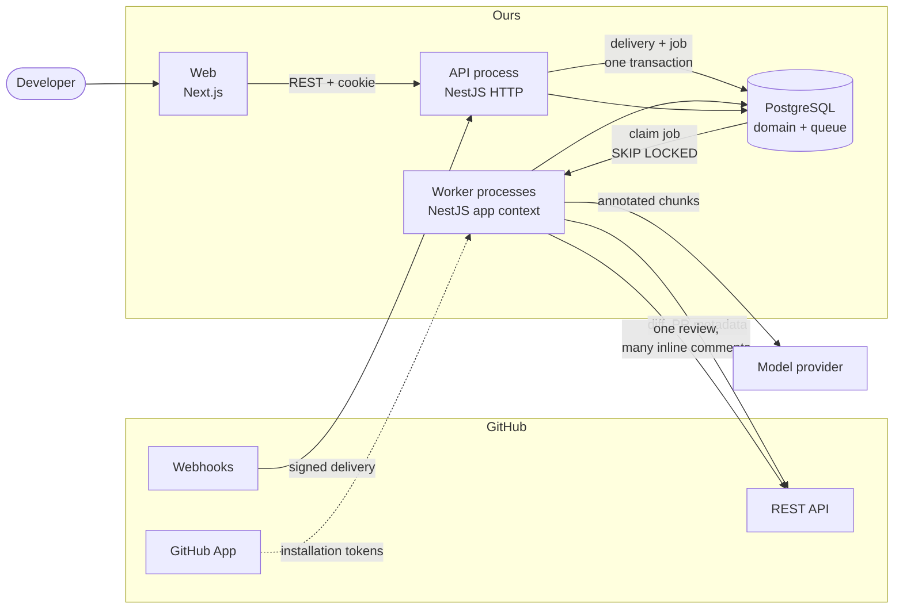

# Architecture

## 1. Purpose and status

AI GitHub PR Reviewer reviews GitHub pull requests automatically: it receives
webhook events for a pull request, analyses the diff with a language model, and
publishes inline review comments back to GitHub, with a dashboard over the
results.

**Status: planning.** The monorepo scaffold exists and is verified (§2). No
business feature is implemented. This document and its companions are planning
artifacts to be reviewed and approved before Phase 1 begins; nothing here has
been applied to the Prisma schema or to application code.

### Companion documents

| Document                                         | Covers                                                                                                                    |
| ------------------------------------------------ | ------------------------------------------------------------------------------------------------------------------------- |
| [data-model.md](./data-model.md)                 | Entity review, ER diagram, proposed Prisma schema, integrity and idempotency rules                                        |
| [github-integration.md](./github-integration.md) | App permissions, the three token flows, webhook ingestion, rate limits, diff position mapping, review publishing          |
| [ai-pipeline.md](./ai-pipeline.md)               | Pipeline stages, file filtering, secret redaction, prompt and output contract, prompt injection, cost control, evaluation |

## 2. Current foundation

Established by inspecting the repository, not from the setup brief.

| Area      | State                                                                                                                                                                                                                                                     |
| --------- | --------------------------------------------------------------------------------------------------------------------------------------------------------------------------------------------------------------------------------------------------------- |
| Workspace | pnpm 11.7.0 workspaces + Turborepo 2.11.10 over `@ai-pr-reviewer/web`, `@ai-pr-reviewer/api`, `@ai-pr-reviewer/shared`. Tasks: `build`, `dev`, `lint`, `typecheck`, `clean`.                                                                              |
| API       | NestJS 12.3.3, ESM. Global prefix `/api/v1` taken from `API_BASE_PATH`. Global `ValidationPipe` with `whitelist` and `forbidNonWhitelisted`. CORS from config, shutdown hooks enabled, Swagger at `/api/v1/docs`. One module: `health`.                   |
| Config    | `config/configuration.ts` is a namespaced factory; `config/env.validation.ts` validates shape and treats every variable as optional.                                                                                                                      |
| Web       | Next.js 16.4.5 App Router, five source files. `QueryProvider` is wired into the root layout but unused. shadcn/ui is configured (`components.json`, `cn()`) with no components installed. Tailwind 4 via the Turbopack loader scoped to `./src/**/*.css`. |
| Shared    | `API_VERSION`, `API_BASE_PATH`, `SERVICE_STATUSES`, `ServiceStatus`, `HealthResponse`.                                                                                                                                                                    |
| Database  | PostgreSQL 18 via Docker Compose, published on host port **5433**. Prisma 7.10.1 installed; schema declares a generator and datasource and **zero models**; no migrations.                                                                                |
| Toolchain | TypeScript 6.0.3, ESLint 9.39.5, Prettier 3.9.10, strict TS plus `noUncheckedIndexedAccess`, `noUnusedLocals`, `noUnusedParameters`.                                                                                                                      |

### Conventions this architecture preserves

These are already in the code and every new module follows them:

1. **ESM with explicit extensions.** Relative imports carry `.js`
   (`./health.service.js`), as NestJS 12 requires.
2. **Contracts live in `packages/shared`,** expressed as a runtime `as const`
   array with the union derived from it (`SERVICE_STATUSES` → `ServiceStatus`),
   and API DTO classes `implement` the shared interface — exactly as
   `HealthResponseDto implements HealthResponse` does today. This is what stops
   the API, the web app and the AI output contract from drifting apart.
3. **Only `configuration.ts` reads `process.env`.** Everything else takes
   `ConfigService`.
4. **One folder per feature** containing `*.module.ts`, `*.controller.ts`,
   `*.service.ts` and a `dto/` directory.
5. **Every `tsconfig.json` extends `tsconfig.base.json`.**
6. **A new environment variable is added in three places:** `.env.example`,
   `config/env.validation.ts`, and `turbo.json`'s `build.env` list — the last one
   is easy to forget and causes Turborepo to serve a build cached under different
   configuration.
7. **No dependency without a reason.** The scaffold deliberately carries no
   Redis, queue or AI package yet.

### Foundation decisions that constrain the design

Carried forward from the scaffold phase, because each one still binds:

- **TypeScript 6, not 7.** `@nestjs/cli` depends on `typescript@~6.0.2`,
  `@nestjs/swagger` peer-requires `^5.5.0 || ^6.0.0`, and `typescript-eslint`
  peer-requires `>=4.8.4 <6.1.0`. TS 6.0.3 is the newest release the whole
  toolchain accepts, and it still emits the `design:paramtypes` metadata NestJS
  dependency injection needs.
- **ESM everywhere.** NestJS 12 scaffolds as ESM, so `apps/api` is ESM and
  `packages/shared` emits ESM to match. This rules out CommonJS-only libraries
  and makes `__dirname` unavailable in new API code.
- **One ESLint toolchain, pinned to 9.x.** NestJS 12 generates an `oxlint` config,
  but `apps/web` needs `eslint-config-next`, whose plugin graph supports only
  ESLint 9. Standardising on ESLint keeps `pnpm lint` uniform.
- **Tailwind's Turbopack rule is scoped to `./src/**/*.css`.** A repository-wide
  `*.css` rule also intercepts the stylesheets `next/font` generates and breaks
  the build.
- **A single `.env` at the repository root,** read by Nest via `envFilePath`, and
  by Next.js and the Prisma CLI through explicit `dotenv` calls.
- **Prisma is configured but unwired.** `@prisma/client` is installed and unused.
  Once models exist, `prisma generate` must run before `tsc`, so Phase 1 adds it
  to the API's `build` script — otherwise a clean checkout will not compile.

## 3. High-level system architecture



Two paths, with different latency budgets:

- **Event path (asynchronous).** GitHub → API → PostgreSQL → worker → GitHub.
  The HTTP leg must finish in well under GitHub's ten-second webhook timeout; the
  worker leg takes as long as the AI needs.
- **Interactive path (synchronous).** Browser → Next.js → API → PostgreSQL. The
  dashboard never calls GitHub or the model provider, which is what keeps it fast
  and what makes discarding user OAuth tokens possible.

### Deployment topology

One build artifact, two entrypoints, one database:

| Process  | Entry            | Scaling                                                                    |
| -------- | ---------------- | -------------------------------------------------------------------------- |
| API      | `dist/main.js`   | Stateless; scale horizontally behind a load balancer.                      |
| Worker   | `dist/worker.js` | Scale horizontally; `FOR UPDATE SKIP LOCKED` makes concurrent claims safe. |
| Postgres | Docker / managed | Single primary is sufficient for the MVP.                                  |

### Why a modular monolith

Both processes load the same NestJS modules from the same build. Within a
process, modules call each other directly — no serialisation, no network failure
mode, no version skew between internal components. Isolation exists where it
actually matters: a runaway AI call or a memory-hungry diff parse happens in a
worker process and cannot block webhook ingestion or the dashboard.

Separate services would add deployment and observability cost immediately and buy
independent scaling we do not need, since the only component with a distinct
scaling profile is the worker — and that is already a separate process. The
boundary to watch is the shared PostgreSQL connection pool (§11).

## 4. Backend modular architecture

```
apps/api/src/
├── main.ts                  HTTP entrypoint                        (exists)
├── worker.ts                worker entrypoint                      NEW
├── app.module.ts            HTTP composition root                  (exists)
├── worker.module.ts         worker composition root                NEW
│
├── common/                  filters, interceptors, decorators      NEW
├── config/                  config factory + env validation        (exists, grows)
├── prisma/                  PrismaModule + PrismaService (global)  NEW
├── health/                  liveness + dependency checks           (exists, grows)
│
├── auth/                    GitHub OAuth login, session, guards    NEW
├── users/                   User + GithubAccount persistence       NEW
├── github/                  app auth, API client, rate limiting    NEW
├── webhooks/                signature check, delivery log, dispatch NEW
├── installations/           installation + repository sync          NEW
├── repositories/            repository registry and settings        NEW
├── pull-requests/           PR snapshot, diff fetch, position map   NEW
├── reviews/                 review lifecycle, findings, publisher   NEW
├── ai/                      prompt build, model call, parse         NEW
└── jobs/                    queue, worker runtime, handler registry NEW
```

### Layering rules

`common`, `config`, `prisma` and `jobs` are platform modules; any module may
import them. The rest are domain modules, with four rules:

1. **`github` is the only module that calls the GitHub API.** Every other module
   goes through `GithubApiClient`, which is where rate limiting, backoff and
   token minting live. Scattering `fetch` calls would scatter the rate limiter.
2. **`ai` is the only module that calls a model provider,** for the same reason
   applied to cost metering.
3. **`jobs` knows nothing about any domain.** Handlers live in the domain module
   that owns the work and register themselves with the queue. The queue never
   imports `reviews`.
4. **HTTP controllers never do slow work.** A controller validates, authorises
   and either reads the database or enqueues a job. No controller calls GitHub or
   the model provider.

### Two abstractions, both justified

Interfaces are a cost, so only two are proposed, each with a single
implementation and a concrete reason:

- **`JobQueue`.** The MVP is backed by PostgreSQL and the project already
  anticipates BullMQ (§6). The seam exists because the swap is likely, not
  because indirection is virtuous.
- **`AiProvider`.** Needed so prompt construction, response parsing and anchor
  validation are testable without a network call or an API key. The justification
  is testability, not speculative multi-provider support.

Everything else — `GithubApiClient`, `PrismaService`, every domain service — is a
concrete class injected directly.

### The worker entrypoint

```ts
// apps/api/src/worker.ts  (proposed)
const app = await NestFactory.createApplicationContext(WorkerModule, { bufferLogs: true });
app.enableShutdownHooks();
await app.get(WorkerRuntime).start();
```

No HTTP server, no Swagger, same modules. `nest build` already compiles
everything under `src`, so `dist/worker.js` appears with no build configuration
change. The supporting wiring:

- `apps/api/package.json`: `"worker": "node dist/worker.js"` and
  `"dev:worker": "nest start --watch --entryFile worker"`.
- `turbo.json`: a `dev:worker` task with `"cache": false, "persistent": true`.
- Root `package.json`: `"dev": "turbo run dev dev:worker"`, so `pnpm dev` still
  starts everything and no `concurrently` dependency is introduced.

### Required changes to existing files

Small, and listed so the review can approve them explicitly:

| File                       | Change                                                   | Reason                                                                                    |
| -------------------------- | -------------------------------------------------------- | ----------------------------------------------------------------------------------------- |
| `src/main.ts`              | `NestFactory.create(AppModule, { rawBody: true })`       | HMAC must be computed over the exact bytes GitHub signed.                                 |
| `src/main.ts`              | Raise the body-size limit on the webhook route           | Express defaults to 100 kB; GitHub payloads reach 25 MB.                                  |
| `webhooks` controller      | Take the raw request, not a DTO                          | The global `forbidNonWhitelisted` pipe would reject GitHub's payloads.                    |
| `config/configuration.ts`  | Add `github`, `ai` and `queue` namespaces                | Keeps `process.env` confined to one file.                                                 |
| `config/env.validation.ts` | Require GitHub and AI secrets when `NODE_ENV=production` | Today every variable is optional, which is right for a scaffold and wrong for production. |
| `packages/shared`          | Add review, finding and repository contracts             | Shared by the API DTOs, the web app and the AI output schema.                             |
| `apps/api/package.json`    | `"build": "prisma generate && nest build"`               | The generated client must exist before `tsc` runs.                                        |

## 5. Frontend application architecture

```
apps/web/src/
├── app/
│   ├── layout.tsx                      root + QueryProvider        (exists)
│   ├── page.tsx                        public landing              (exists)
│   ├── login/page.tsx                                              NEW
│   └── (dashboard)/
│       ├── layout.tsx                  shell + auth gate           NEW
│       ├── dashboard/page.tsx          overview                    NEW
│       ├── repositories/page.tsx       list, enable/disable        NEW
│       ├── pulls/[id]/page.tsx         review detail + findings    NEW
│       └── settings/page.tsx                                       NEW
├── components/
│   ├── ui/                             shadcn primitives           NEW
│   ├── providers/                      query-provider              (exists)
│   └── <feature>/                      feature components          NEW
├── lib/
│   ├── api/                            typed client + query keys   NEW
│   ├── auth/                                                       NEW
│   └── utils.ts                        cn()                        (exists)
└── middleware.ts                       redirect unauthenticated    NEW
```

No new top-level directory convention is introduced: the existing
`components/` + `lib/` split is kept rather than adding a `features/` tree.

### Data strategy

- **Server Components** for anything that is read once per navigation —
  repository lists, review detail, findings. The server fetch forwards the
  session cookie, so there is no client-side loading waterfall.
- **TanStack Query** for anything that changes while the user watches: polling a
  running review's status (`refetchInterval` while `status` is `QUEUED` or
  `RUNNING`), and mutations such as toggling `reviewEnabled` with optimistic
  update and rollback. The provider is already wired; this is its first use.
- Query keys are centralised in `lib/api/query-keys.ts`. Request and response
  types come from `packages/shared`, never hand-written in the web app.

Live progress uses polling, not WebSockets. A review takes tens of seconds and a
handful of viewers will ever watch one; Server-Sent Events are the upgrade path
if polling becomes visible in load, and WebSockets are not justified.

### Session handling

The GitHub OAuth callback is handled by the **API**, which already holds the
client secret, and which sets an `httpOnly`, `Secure`, `SameSite=Lax` session
cookie. The browser then calls the API directly with `credentials: 'include'`.

This requires the web app and API to share a registrable domain in production
(`app.example.com` and `api.example.com`). In development, `localhost:3000` and
`localhost:4000` are already same-site because ports do not affect site identity,
so this works today with the CORS configuration that is already in `main.ts`.

The alternative — Next.js route handlers proxying every call as a BFF — removes
the shared-domain requirement but adds a hop, a second place for auth logic and a
second deployment to reason about. It stays the documented fallback if the
domains cannot be aligned.

`middleware.ts` redirects unauthenticated users out of `(dashboard)` for UX only.
Authorisation is enforced in the API on every request and is never inferred from
the client (§10).

## 6. Background job architecture

### Queue choice: PostgreSQL, not Redis

The brief anticipated BullMQ. The proposal is to start with a PostgreSQL-backed
queue, for one decisive reason and several supporting ones.

The decisive reason is **transactional enqueue**. Webhook ingestion must record
"I have seen delivery X" and "there is work to do for X" atomically. With the
queue in the same database, that is one transaction (see
[data-model §5](./data-model.md#5-integrity-and-idempotency-rules)). With an
external broker it is a dual write: the delivery row commits, the enqueue fails,
and the delivery is permanently marked seen with no work queued — a silently
dropped review. Avoiding that needs an outbox table and a relay, which is
strictly more machinery than the Postgres queue it was meant to replace.

Supporting reasons: one fewer component to run, secure and back up; job history
joinable to domain data in plain SQL; idempotency expressed as unique constraints
rather than broker semantics; and a workload — a few jobs per pull request — that
is nowhere near the throughput where Postgres queues struggle.

What we give up, honestly: polling latency of about a second instead of a blocking
pop; no mature job dashboard; no built-in cron, rate-limiter or priority
primitives; and a lease-reaper we have to write and get right. The migration
trigger is in §11.

### Claiming work

```sql
UPDATE jobs
SET status = 'RUNNING', locked_at = now(), locked_by = $1, attempts = attempts + 1
WHERE id = (
  SELECT id FROM jobs
  WHERE status = 'PENDING' AND run_at <= now()
  ORDER BY priority DESC, run_at
  FOR UPDATE SKIP LOCKED
  LIMIT 1
)
RETURNING *;
```

`SKIP LOCKED` lets N workers claim distinct rows without blocking each other. A
reaper returns jobs whose `locked_at` is older than the lease to `PENDING`, which
is what makes a worker crash recoverable — and is the part most likely to harbour
a bug, so it needs a test of its own.

### Job types

| Type                         | Priority | Notes                                                                           |
| ---------------------------- | -------- | ------------------------------------------------------------------------------- |
| `installation.sync`          | high     | Reconcile installation and repository rows from an event.                       |
| `pull_request.analyze`       | normal   | Fetch diff, build position map, call the model, persist findings.               |
| `review.publish`             | high     | Post one GitHub review. Cheap, so it outranks analysis and ships finished work. |
| `maintenance.prune_webhooks` | low      | Retention for `WebhookDelivery.payload`.                                        |

**Analysis and publishing are separate jobs, and that split is the point.** If
they shared a job, a GitHub `502` while posting would retry the whole job and pay
for the AI analysis a second time. Splitting them makes the expensive step run
once and the fragile step retry freely.

Handlers resolve GitHub ids to local rows themselves and create missing
installation or repository rows on demand, so ingestion never has to wait for a
sync to have happened.

### Retries and cancellation

- Exponential backoff with full jitter, `maxAttempts` default 5, then `FAILED`
  and visible in the dashboard.
- Rate-limit responses reschedule at `x-ratelimit-reset` rather than consuming an
  attempt on a known-closed door.
- A new head commit cancels `PENDING` analyses for older commits of the same pull
  request; in-flight ones are abandoned at publish time
  ([github-integration §3](./github-integration.md#3-webhook-ingestion)).
- `SIGTERM` stops claiming, finishes the current job within a grace period, and
  releases its lease — `enableShutdownHooks()` is already called in `main.ts` and
  the worker does the same.

## 7. GitHub integration

Full detail in [github-integration.md](./github-integration.md). The decisions
that shape the rest of the system:

- **GitHub App**, not an OAuth app, with `Pull requests: Read & Write`,
  `Contents: Read`, `Metadata: Read` and nothing else. The app cannot modify code.
- **Installation tokens scoped to a single repository** per job, cached in memory
  for 55 minutes, never persisted.
- **User OAuth tokens are discarded after sign-in.** They establish identity and
  installation access, then nothing. All repository access uses installation
  tokens, which is possible only because the dashboard reads our database.
- **Inline comments use `line` + `side`, never the legacy `position` offset.**
- **One review per analysis** carrying every inline comment, which collapses a
  20-call content-creating burst into one request.
- **Every finding is validated against a position map** parsed from the real
  patch before it can be posted, because GitHub rejects the entire review if one
  comment points outside the diff.

## 8. AI review pipeline

Full detail in [ai-pipeline.md](./ai-pipeline.md). The load-bearing ideas:

- **Anchors.** Every line in the prompt is prefixed with `R<n>` or `L<n>`, and a
  finding must cite one of those tokens. The anchor is simultaneously the
  instruction, the model's answer and the validation key, which makes a
  side/line mismatch structurally impossible.
- **Structured output only.** A JSON schema the model fills in; one repair
  attempt on invalid output; a failed chunk degrades coverage instead of failing
  the review.
- **The model cannot approve a pull request.** `event` is hard-coded to
  `COMMENT`. Since the diff is untrusted input authored by the person being
  reviewed, prompt injection must not be able to reach a merge decision.
- **Secrets are redacted before the diff leaves our network,** and a redacted
  secret is still reported as a `CRITICAL` security finding.
- **Metering is in the call path.** Every model call writes an `AiUsage` row,
  including failures, with per-review and per-installation budget ceilings.
- **Unmappable findings are kept,** rendered in the summary body, and counted —
  the unmappable rate is the primary quality signal for the prompt.

## 9. MVP scope

### In scope

| Capability                    | Definition of done                                                                                                      |
| ----------------------------- | ----------------------------------------------------------------------------------------------------------------------- |
| App installation lifecycle    | Install, uninstall, suspend and repository add/remove are reflected in the database.                                    |
| Webhook ingestion             | Signature verified, delivery deduplicated, acknowledged in well under 10 s.                                             |
| Automatic review              | `opened`, `reopened`, `synchronize` and `ready_for_review` produce exactly one review per head commit.                  |
| AI analysis                   | Filtered diff, chunked, structured findings, anchors validated.                                                         |
| Inline publishing             | One `COMMENT` review with validated inline comments plus a summary.                                                     |
| Per-repository enable/disable | A repository can be excluded without uninstalling the app.                                                              |
| Dashboard                     | GitHub sign-in; list installations, repositories, pull requests, reviews and findings; live status of a running review. |
| Cost visibility               | Per-installation AI spend queryable and shown in the dashboard.                                                         |
| Operability                   | Health endpoint reporting database and queue; structured logs correlated by delivery and review id.                     |

### Explicitly out of scope

| Deferred                                | Why not now                                                                     |
| --------------------------------------- | ------------------------------------------------------------------------------- |
| Slash-command re-review (`/review`)     | Needs `issue_comment` and a command parser; the automatic path must work first. |
| Check runs / merge gating               | Needs `Checks: Write` and a decision about whether a bot may block a merge.     |
| Suggestion blocks (committable patches) | High value, but needs exact line-range alignment; raises the validation bar.    |
| Cross-file and architectural review     | A per-chunk reviewer cannot see it. The most significant MVP limitation (§11).  |
| Finding feedback loop                   | Needs `FindingFeedback` and UI; required before prompt tuning is meaningful.    |
| Billing, plans, teams, RBAC             | Metering first, charging later.                                                 |
| Multi-provider or self-hosted models    | One provider, well instrumented.                                                |
| GitLab / Bitbucket                      | The position-mapping work is platform-specific and would double.                |
| GitHub Enterprise Server                | Needs a configurable API base URL; cheap to add, expensive to retrofit.         |

## 10. Security architecture

### Trust boundaries

Three inputs are untrusted and each is handled as such:

1. **Webhook requests.** Anyone can POST to the endpoint. HMAC-SHA256 over the
   raw body with `crypto.timingSafeEqual`; unsigned or mismatched requests get
   `401` with nothing written. This is why `rawBody: true` is a required change
   rather than a nicety (§4).
2. **Pull request content.** The diff is authored by the person under review and
   is fed to a model whose output drives API calls. Defences in
   [ai-pipeline §6](./ai-pipeline.md#6-prompt-injection); the structural one is
   that the model can only ever produce a `COMMENT` review, so a successful
   injection yields a useless review, not an approved merge.
3. **Dashboard requests.** Session cookies prove identity, never authorisation.

### Authorisation

Every dashboard query is scoped `User → UserInstallation → Installation →
Repository`. A guard resolves the caller's accessible installation ids once per
request, and services filter on them. A repository or review id from the client
is never trusted — the scope filter is applied in the same query that fetches the
row, not checked afterwards.

Because ids are opaque UUIDs, IDOR is the most likely security defect in the
dashboard, and it is the thing to write tests for first.

### Secrets

| Secret              | Storage                  | Notes                                                |
| ------------------- | ------------------------ | ---------------------------------------------------- |
| App private key     | Env, base64-encoded PEM  | Base64 so newlines survive env transport.            |
| Webhook secret      | Env                      | Timing-safe comparison only.                         |
| OAuth client secret | Env, API process only    | Never reaches the web app or the browser.            |
| Installation tokens | Process memory, 55 min   | Not persisted, so there is no token store to breach. |
| User OAuth tokens   | **Not stored at all**    | Discarded after sign-in (§7).                        |
| AI provider key     | Env, worker process only | The API process does not need it.                    |

Logging rules: never log a token, the private key, a webhook body or diff
content. Redact `authorization` headers in error reporting. Logs carry
`deliveryId`, `installationId`, `reviewId` and `jobId` for correlation — ids, not
payloads.

### Data handling

- Customer code is **not persisted**. Diffs are fetched per run and held in
  memory. The database stores findings, which quote only the lines a finding is
  about.
- `WebhookDelivery.payload` is retained on a schedule (30 days proposed) and
  pruned by `maintenance.prune_webhooks`.
- Uninstalling soft-deletes the installation to preserve history; a hard-deletion
  path for erasure requests is an open question (§13).
- Code crosses a third-party boundary when sent to the model provider. That is a
  disclosure customers must be told about, and it is the reason for secret
  redaction and for the provider data-policy question in §13.

### Platform hardening

Global `ValidationPipe` with `whitelist` and `forbidNonWhitelisted` is already in
place for all DTO routes. Still to add: request rate limiting on dashboard and
auth routes (the webhook route is gated by its signature instead), CSRF
protection on cookie-authenticated mutations, and a dependency audit in CI.

## 11. Trade-offs and rejected alternatives

| Decision                                  | Alternative                       | Why this way                                                             | Cost accepted                                                                  | Revisit when                                                             |
| ----------------------------------------- | --------------------------------- | ------------------------------------------------------------------------ | ------------------------------------------------------------------------------ | ------------------------------------------------------------------------ |
| PostgreSQL queue                          | BullMQ + Redis                    | Transactional enqueue removes the dual-write hole; one less component.   | ~1 s polling latency, no job UI, we maintain the lease reaper.                 | Sustained throughput needs blocking pops, or delayed/cron jobs multiply. |
| Modular monolith, separate worker process | Microservices                     | Direct calls, one artifact; isolation where it matters is already there. | Shared connection pool; one deploy ships everything.                           | A module needs independent scaling or a different runtime.               |
| `line` + `side`                           | Legacy `position` offset          | A finding naturally carries a file line, not a diff offset.              | Must build and maintain a position map.                                        | Never; `position` is strictly worse.                                     |
| One batched review                        | One API call per comment          | Collapses a content-creating burst into one request; one notification.   | A single bad position `422`s the whole review, so pre-validation is mandatory. | Never.                                                                   |
| Analysis and publishing as separate jobs  | One job                           | A publish retry must not re-pay for AI analysis.                         | Two rows, one more state transition.                                           | Never.                                                                   |
| Do not persist diffs                      | Store diffs for re-rendering      | Smallest possible footprint of customer code.                            | Extra GitHub calls; historical findings cannot be shown in context.            | Customers ask to see old findings in context, or API budget tightens.    |
| Discard user OAuth tokens                 | Store encrypted, call GitHub live | Removes the highest-value secret store entirely.                         | `UserInstallation` goes stale between sign-ins.                                | Live GitHub data is needed in the dashboard.                             |
| Installation tokens in memory             | Encrypted in Postgres             | No token store, no rotation story.                                       | Each worker mints its own token.                                               | Token minting shows up in rate-limit accounting.                         |
| Soft delete on uninstall                  | Hard delete                       | Preserves history and audit trail.                                       | Needs a separate erasure path for compliance.                                  | A customer exercises a deletion right.                                   |
| Polling for review status                 | WebSockets / SSE                  | Tens of seconds of latency and few watchers.                             | Wasted requests while idle.                                                    | Polling shows in load, or sub-second updates are wanted.                 |
| Session cookie set by the API             | Next.js BFF proxy                 | One place for auth logic, no extra hop.                                  | Web and API must share a registrable domain.                                   | Domains cannot be aligned.                                               |

### Where this architecture is weakest

Stated plainly, because these are the things most likely to disappoint:

1. **No cross-file reasoning.** Chunk-level review cannot see that a changed
   function signature breaks a caller in another file. This is the most probable
   reason users will call the reviews shallow, and no amount of prompt tuning
   fixes it — it needs a different context strategy (repository map, symbol
   index) that the MVP does not have.
2. **No cross-review deduplication.** Push three times and an unaddressed finding
   is reported three times. `fingerprint` is unique per review, not per pull
   request. This is the most likely source of user annoyance and is cheap to fix
   once measured, but it is not in the MVP.
3. **Quality is unmeasured at launch.** With no test framework and no evaluation
   harness, "is the reviewer any good?" is unanswerable except anecdotally.
4. **Authorisation staleness.** A collaborator whose GitHub access is revoked
   keeps dashboard visibility until their next sign-in. Acceptable only because
   the dashboard exposes findings rather than source.
5. **Shared connection pool.** API and worker processes share one Postgres
   primary. A burst of workers can starve HTTP request handling. Mitigation is
   explicit per-process pool sizing from the first deployment, not later.
6. **Review latency versus developer workflow.** If a review lands minutes after
   the push, developers will have merged already. Time-to-first-comment is a
   product metric, not just an operational one.

## 12. Implementation roadmap

Each phase is independently reviewable and leaves the repository green
(`pnpm lint`, `pnpm typecheck`, `pnpm build`).

| Phase | Deliverable                                                                                                                                                                                                                             | Exit criteria                                                                                             |
| ----- | --------------------------------------------------------------------------------------------------------------------------------------------------------------------------------------------------------------------------------------- | --------------------------------------------------------------------------------------------------------- |
| **0** | This architecture                                                                                                                                                                                                                       | Reviewed and approved.                                                                                    |
| **1** | **Data layer.** Prisma models from [data-model.md](./data-model.md), first migration, `PrismaModule`, `prisma generate` in the build, health check reporting the database. Test framework (Vitest, per NestJS 12's default) added here. | Migration applies to a clean database; `/api/v1/health` reports database status; a test runs in CI.       |
| **2** | **GitHub authentication.** App JWT, installation tokens, `GithubApiClient` with rate-limit accounting and backoff.                                                                                                                      | Can mint a scoped installation token and read a PR's files against a real app.                            |
| **3** | **Webhook ingestion.** `rawBody`, signature verification, delivery dedupe, installation and repository sync.                                                                                                                            | A replayed delivery is a no-op; install/uninstall round-trips correctly.                                  |
| **4** | **Job queue and worker.** `Job` table, claim query, reaper, `worker.ts`, `dev:worker` wiring.                                                                                                                                           | Two workers process a backlog without double-processing; a killed worker's job is reclaimed.              |
| **5** | **Diff and position map.** Paginated file fetch, patch parser, anchor set, validator.                                                                                                                                                   | Unit tests cover added, removed, renamed, context-line and no-newline cases.                              |
| **6** | **AI analysis.** Filtering, redaction, chunking, prompt, structured output, validation, `AiUsage`.                                                                                                                                      | A real PR produces validated findings with recorded cost; no finding fails position validation in GitHub. |
| **7** | **Review publishing.** Single batched review, stale-head abort, summary with unmappable findings.                                                                                                                                       | Inline comments land on the intended lines of a real pull request.                                        |
| **8** | **Auth and dashboard.** OAuth login, session cookie, scoped queries, dashboard screens.                                                                                                                                                 | A user sees exactly their installations' repositories and nothing else.                                   |
| **9** | **Hardening.** Rate limiting, CSRF, retention job, per-process pool sizing, structured logging, dashboards.                                                                                                                             | Load test passes; no secret appears in any log.                                                           |

Phases 1–7 deliver a working reviewer with no user interface — testable entirely
through GitHub, which is deliberate: the product's value is proven before any
dashboard work.

## 13. Missing requirements and open questions

Gaps in the brief that need an answer. The first three block implementation; the
rest block launch.

### Blocking Phase 1

1. **Test framework.** The repository has none. NestJS 12 now defaults to Vitest
   rather than Jest. This must be settled in Phase 1 — the position-map parser
   and the queue reaper are exactly the code that must not be verified by hand.
2. **AI provider and data policy.** Which provider, and does its agreement
   guarantee no training on submitted code? The answer determines what we may
   tell a customer with private repositories, so it precedes writing the client.
3. **Deployment target.** Container platform, process manager and secret store
   all affect the worker model and how the private key is delivered. Unknown
   today.

### Blocking launch

4. **Observability stack.** No logging, tracing or error-reporting choice exists.
   An asynchronous pipeline is undebuggable without correlated logs.
5. **Secret redaction policy.** §10 proposes redaction; what is actually
   acceptable to customers is a policy question.
6. **Erasure path.** Soft delete preserves history; a deletion request needs a
   defined, tested hard path.
7. **Which pull requests to skip.** Drafts, bot authors and very large PRs all
   cost money for little value. Proposed defaults — skip drafts, skip bots, cap
   at 50 files — need a product decision.
8. **Noise policy.** Maximum comments per review and the minimum severity to
   publish. Proposed: 15 and `MEDIUM`. This single setting most determines
   whether the tool feels useful or spammy.
9. **Review quality evaluation.** A golden set of pull requests with known
   defects, and the metrics in
   [ai-pipeline §9](./ai-pipeline.md#9-quality-evaluation). Without it, prompt
   changes are guesswork.
10. **Budget policy.** What is the per-installation monthly ceiling, and what does
    a customer see when it is hit?

### Product definition, still open

11. **Multi-tenancy and billing.** Metering exists in the model; pricing does not.
12. **Language and repository scope.** A declared set of languages, or
    best-effort across everything?
13. **Review depth tiers.** Is `claude-opus-5-5` a paid tier, a per-repository
    setting, or automatic for security-sensitive paths?
14. **Repository conventions as input.** Should the reviewer read `CLAUDE.md`,
    `AGENTS.md` or a contributing guide to match house style? Valuable, and also
    a second untrusted input channel.
15. **Human-in-the-loop.** Does a maintainer ever see findings before they are
    posted publicly on the pull request?

## 14. Summary of decisions

| #   | Decision                                                                                                                                                 |
| --- | -------------------------------------------------------------------------------------------------------------------------------------------------------- |
| 1   | Modular monolith; one build, HTTP process plus horizontally scalable worker processes.                                                                   |
| 2   | PostgreSQL-backed job queue, chosen for transactional enqueue; BullMQ behind a `JobQueue` seam if throughput demands it.                                 |
| 3   | Three-layer idempotency: unique webhook delivery id, unique job dedupe key, unique review dedupe key per commit.                                         |
| 4   | GitHub App with read-only code access; installation tokens scoped per repository, held in memory, never persisted.                                       |
| 5   | User OAuth tokens discarded after sign-in; the dashboard reads our own database.                                                                         |
| 6   | Findings cite an anchor token (`R41`) validated against a position map parsed from the real patch; unmappable findings are kept, counted and summarised. |
| 7   | One batched `COMMENT` review per analysis; the model can never approve or block a merge.                                                                 |
| 8   | Analysis and publishing are separate jobs so a publish retry never re-pays for AI.                                                                       |
| 9   | AI metering in the call path, with per-review and per-installation budgets.                                                                              |
| 10  | Customer code is never persisted; secrets are redacted before leaving our network.                                                                       |
| 11  | Existing conventions preserved: ESM with `.js` imports, contracts in `packages/shared`, `process.env` only in `configuration.ts`.                        |

**Recommended first implementation phase: Phase 1, the data layer** — Prisma
models, the first migration, `PrismaModule`, `prisma generate` wired into the
build, a health check that reports database connectivity, and the Vitest setup
the repository still lacks. Everything else in the roadmap depends on persistence,
and Phase 1 is also where the test framework question has to be answered rather
than deferred again.
