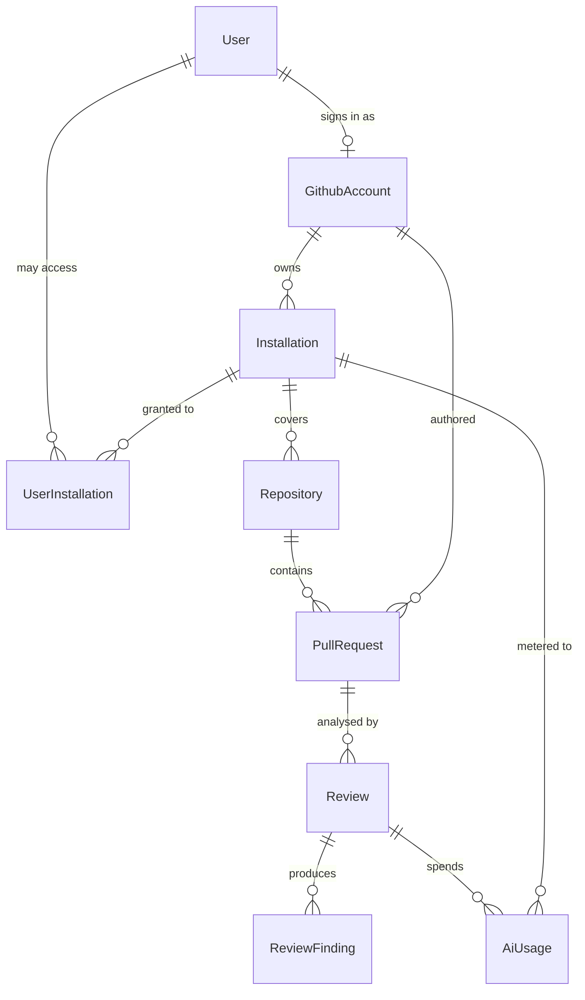

# Data model (proposal)

> **Planning artifact.** Nothing here has been applied. `apps/api/prisma/schema.prisma`
> still declares zero models and no migrations exist. This document is the input
> to Phase 1 of the [implementation roadmap](./architecture.md#12-implementation-roadmap).

## 1. Entity review

The brief listed nine candidate entities. Each is assessed below, plus two that
the architecture cannot work without and which the brief did not mention.

| Entity             | Verdict                         | Reasoning                                                                                                                                                            |
| ------------------ | ------------------------------- | -------------------------------------------------------------------------------------------------------------------------------------------------------------------- |
| `User`             | MVP                             | Stable internal identity and the subject of a session. Thin, but see §2 for why it is not merged into `GithubAccount`.                                               |
| `GithubAccount`    | MVP                             | Must exist separately: installation **owners** and PR **authors** are GitHub accounts that are usually not our users, and may be organisations.                      |
| `Installation`     | MVP                             | The unit of authentication (installation tokens) and the natural tenant boundary.                                                                                    |
| `Repository`       | MVP                             | Review enablement and settings attach here.                                                                                                                          |
| `PullRequest`      | MVP                             | Needed to key reviews and to render the dashboard without live GitHub calls.                                                                                         |
| `Review`           | MVP                             | One analysis run against one head commit. Carries the idempotency key.                                                                                               |
| `ReviewFinding`    | MVP                             | The product's actual output, including findings that could **not** be mapped to a diff position.                                                                     |
| `WebhookDelivery`  | MVP                             | The deduplication record. Without it, GitHub's retries cause duplicate reviews.                                                                                      |
| `AiUsage`          | MVP                             | Cost control is not optional when every review spends money. Needed from the first AI call, not bolted on later.                                                     |
| `Job`              | **MVP, missing from the brief** | The queue lives in the database so that "record delivery + enqueue work" is one transaction. See [architecture §6](./architecture.md#6-background-job-architecture). |
| `UserInstallation` | **MVP, missing from the brief** | Authorisation join. Without it there is no way to answer "may this user see this repository?" without calling GitHub on every request.                               |

### Deferred entities

| Entity                               | Trigger for adding it                                                              |
| ------------------------------------ | ---------------------------------------------------------------------------------- |
| `FindingFeedback`                    | When we want a per-finding useful/not-useful signal to measure review quality.     |
| `RepositorySettings`                 | When `Repository.settings` (JSON) needs querying, validation or per-field history. |
| `PromptVersion` / `ReviewEvaluation` | When prompts are A/B tested and reviews scored against a golden set.               |
| `Subscription` / `Plan`              | When usage is billed rather than merely metered.                                   |
| `Team` / `Membership`                | When permissions need to be finer than "can access the installation".              |
| `AuditLog`                           | When settings changes need attribution, which is likely a compliance requirement.  |
| `ApiKey`                             | When a CLI or third party calls the API without a browser session.                 |
| `DiffChunkCache`                     | When re-runs over unchanged chunks become a measurable AI cost.                    |
| `Session`                            | Only if sessions move from signed cookies to server-side storage.                  |

## 2. Why `User` and `GithubAccount` are separate

Merging them is tempting for an MVP with GitHub-only login, and it would remove a
join. It is still the wrong model here, for a reason that has nothing to do with
future non-GitHub authentication:

- An installation is owned by a GitHub **user or organisation**. That owner is
  usually not a customer of ours and must never imply an account on our side.
- A pull request author is a GitHub account we must display and may never meet as
  a user, including bots such as `dependabot[bot]`.
- GitHub logins are mutable; the numeric `id` is not. A single table conflating
  "person who signed in" with "GitHub entity we observed" forces nullable session
  columns onto rows that will never sign in.

So `GithubAccount` is a projection of GitHub's world, and `User` is our own
identity, linked one-to-one and only for accounts that have actually signed in.

## 3. ER diagram



`WebhookDelivery` and `Job` are deliberately absent: neither holds a foreign key.
Ingestion must succeed for an installation or repository we have never seen, and a
queue row must survive the deletion of whatever caused it. Both reference GitHub's
numeric ids as plain columns and resolve them inside the job handler instead.

## 4. Proposed Prisma schema

Written against Prisma 7 and the existing `prisma-client` generator. Models are
`PascalCase` with explicit `@@map` to `snake_case` tables; nothing in the
repository establishes this yet, so these models set the convention.

### Identity

```prisma
model User {
  id          String    @id @default(uuid(7))
  email       String?   @unique
  displayName String?
  lastLoginAt DateTime?
  createdAt   DateTime  @default(now())
  updatedAt   DateTime  @updatedAt

  githubAccount GithubAccount?
  installations UserInstallation[]

  @@map("users")
}

model GithubAccount {
  id String @id @default(uuid(7))

  /// Numeric GitHub id, stable when a login is renamed.
  githubId  BigInt            @unique
  login     String
  type      GithubAccountType
  avatarUrl String?
  createdAt DateTime          @default(now())
  updatedAt DateTime          @updatedAt

  /// Set only once this account has signed in to the dashboard.
  userId String? @unique
  user   User?   @relation(fields: [userId], references: [id], onDelete: SetNull)

  ownedInstallations   Installation[]
  authoredPullRequests PullRequest[]  @relation("PullRequestAuthor")

  @@index([login])
  @@map("github_accounts")
}

enum GithubAccountType {
  USER
  ORGANIZATION
}
```

### Installation and access

```prisma
model Installation {
  id                   String @id @default(uuid(7))
  githubInstallationId BigInt @unique

  accountId String
  account   GithubAccount @relation(fields: [accountId], references: [id], onDelete: Restrict)

  repositorySelection RepositorySelection

  /// Permission and event snapshots from the installation payload, kept so a
  /// permission downgrade can be detected without calling GitHub.
  permissions Json
  events      String[]

  suspendedAt DateTime?

  /// Soft delete: review history outlives the installation.
  uninstalledAt DateTime?
  createdAt     DateTime  @default(now())
  updatedAt     DateTime  @updatedAt

  repositories Repository[]
  users        UserInstallation[]
  aiUsage      AiUsage[]

  @@index([uninstalledAt])
  @@map("installations")
}

enum RepositorySelection {
  ALL
  SELECTED
}

model UserInstallation {
  userId         String
  installationId String
  grantedAt      DateTime @default(now())

  user         User         @relation(fields: [userId], references: [id], onDelete: Cascade)
  installation Installation @relation(fields: [installationId], references: [id], onDelete: Cascade)

  @@id([userId, installationId])
  @@map("user_installations")
}
```

### Repositories and pull requests

```prisma
model Repository {
  id           String @id @default(uuid(7))
  githubRepoId BigInt @unique

  installationId String
  installation   Installation @relation(fields: [installationId], references: [id], onDelete: Cascade)

  ownerLogin String
  name       String

  /// Indexed but NOT unique: repositories are renamed and transferred, and two
  /// rows can legitimately hold the same `fullName` while a rename is observed.
  fullName      String
  private       Boolean
  defaultBranch String

  reviewEnabled Boolean @default(true)

  /// Path filters and severity threshold. Promote to a table once queried.
  settings Json?

  archivedAt DateTime?
  removedAt  DateTime?
  createdAt  DateTime  @default(now())
  updatedAt  DateTime  @updatedAt

  pullRequests PullRequest[]

  @@index([installationId, reviewEnabled])
  @@index([fullName])
  @@map("repositories")
}

model PullRequest {
  id         String @id @default(uuid(7))
  githubPrId BigInt @unique

  repositoryId String
  repository   Repository @relation(fields: [repositoryId], references: [id], onDelete: Cascade)
  number       Int

  title String
  state PullRequestState
  draft Boolean          @default(false)

  authorId String?
  author   GithubAccount? @relation("PullRequestAuthor", fields: [authorId], references: [id], onDelete: SetNull)

  headRef String

  /// VarChar(64) rather than Char(40): object ids become 64 hex characters when
  /// a repository moves to SHA-256.
  headSha String @db.VarChar(64)
  baseRef String
  baseSha String @db.VarChar(64)

  openedAt  DateTime
  closedAt  DateTime?
  mergedAt  DateTime?
  createdAt DateTime  @default(now())
  updatedAt DateTime  @updatedAt

  reviews Review[]

  @@unique([repositoryId, number])
  @@index([repositoryId, state])
  @@map("pull_requests")
}

enum PullRequestState {
  OPEN
  CLOSED
  MERGED
}
```

### Reviews and findings

```prisma
model Review {
  id String @id @default(uuid(7))

  pullRequestId String
  pullRequest   PullRequest @relation(fields: [pullRequestId], references: [id], onDelete: Cascade)

  /// The commit the analysis was computed against. Findings are only valid for
  /// this commit's diff.
  headSha String        @db.VarChar(64)
  trigger ReviewTrigger
  status  ReviewStatus  @default(QUEUED)

  /// "<pullRequestId>:<headSha>" for automatic runs, NULL for manual re-runs.
  /// Postgres permits many NULLs in a unique index, so automatic reviews are
  /// idempotent per commit while a human can still request another one.
  dedupeKey String? @unique

  githubReviewId BigInt?

  summary           String? @db.Text
  filesAnalyzed     Int     @default(0)
  findingsTotal     Int     @default(0)
  findingsPublished Int     @default(0)

  error       String?   @db.Text
  startedAt   DateTime?
  completedAt DateTime?
  createdAt   DateTime  @default(now())
  updatedAt   DateTime  @updatedAt

  findings ReviewFinding[]
  aiUsage  AiUsage[]

  @@index([pullRequestId, createdAt])
  @@index([status, createdAt])
  @@map("reviews")
}

enum ReviewTrigger {
  PULL_REQUEST_OPENED
  PULL_REQUEST_SYNCHRONIZED
  MANUAL
}

enum ReviewStatus {
  QUEUED
  RUNNING
  PUBLISHING
  COMPLETED
  FAILED
  SKIPPED
}

model ReviewFinding {
  id String @id @default(uuid(7))

  reviewId String
  review   Review @relation(fields: [reviewId], references: [id], onDelete: Cascade)

  /// Location exactly as the model proposed it, retained even when it fails
  /// validation so that unmappable output stays measurable.
  filePath  String
  side      DiffSide @default(RIGHT)
  startLine Int?
  endLine   Int?

  severity FindingSeverity
  category FindingCategory
  title    String
  body     String          @db.Text

  /// Body of a GitHub suggestion block, when the model proposed a patch.
  suggestion String? @db.Text
  confidence Float?

  status           FindingStatus @default(PENDING)
  unmappableReason String?
  githubCommentId  BigInt?

  /// hash(filePath, startLine, category, normalised title) — collapses the same
  /// observation reported twice within one run.
  fingerprint String
  createdAt   DateTime @default(now())

  @@unique([reviewId, fingerprint])
  @@index([reviewId, status])
  @@map("review_findings")
}

enum DiffSide {
  LEFT
  RIGHT
}

enum FindingSeverity {
  INFO
  LOW
  MEDIUM
  HIGH
  CRITICAL
}

enum FindingCategory {
  BUG
  SECURITY
  PERFORMANCE
  MAINTAINABILITY
  STYLE
  TESTING
  DOCUMENTATION
}

enum FindingStatus {
  PENDING
  PUBLISHED
  UNMAPPABLE
  SUPPRESSED
  DUPLICATE
  FAILED
}
```

### Ingestion and queue

```prisma
model WebhookDelivery {
  id String @id @default(uuid(7))

  /// X-GitHub-Delivery. This unique constraint is the whole deduplication
  /// mechanism: a replayed delivery loses the insert and is acknowledged.
  deliveryId String  @unique
  event      String
  action     String?

  /// Loose references by GitHub id, with no foreign keys, so ingestion never
  /// fails for an installation or repository we have not synced yet.
  githubInstallationId BigInt?
  githubRepoId         BigInt?

  status   DeliveryStatus @default(RECEIVED)
  attempts Int            @default(0)
  error    String?        @db.Text

  /// Raw payload, pruned on a retention schedule (architecture §10).
  payload     Json
  receivedAt  DateTime  @default(now())
  processedAt DateTime?

  @@index([event, action])
  @@index([status, receivedAt])
  @@index([receivedAt])
  @@map("webhook_deliveries")
}

enum DeliveryStatus {
  RECEIVED
  PROCESSED
  IGNORED
  FAILED
}

model Job {
  id      String    @id @default(uuid(7))
  type    String
  payload Json
  status  JobStatus @default(PENDING)

  /// Higher runs first. Publishing outranks analysis so finished work ships.
  priority Int @default(0)

  /// Collapses duplicate work, e.g. two `synchronize` events for one commit.
  dedupeKey   String?  @unique
  runAt       DateTime @default(now())
  attempts    Int      @default(0)
  maxAttempts Int      @default(5)

  lockedAt DateTime?
  lockedBy String?

  lastError   String?   @db.Text
  createdAt   DateTime  @default(now())
  updatedAt   DateTime  @updatedAt
  completedAt DateTime?

  @@index([status, runAt, priority])
  @@index([lockedAt])
  @@map("jobs")
}

enum JobStatus {
  PENDING
  RUNNING
  COMPLETED
  FAILED
  CANCELLED
}
```

### AI metering

```prisma
model AiUsage {
  id String @id @default(uuid(7))

  installationId String?
  installation   Installation? @relation(fields: [installationId], references: [id], onDelete: SetNull)
  reviewId       String?
  review         Review?       @relation(fields: [reviewId], references: [id], onDelete: SetNull)

  provider String
  model    String

  /// `review_chunk` | `summarise` | `repair`
  operation String

  inputTokens       Int
  outputTokens      Int
  cachedInputTokens Int @default(0)

  /// Integer micro-USD. Money is never stored as a float.
  costMicros Int
  latencyMs  Int

  succeeded Boolean @default(true)
  errorCode String?

  createdAt DateTime @default(now())

  @@index([installationId, createdAt])
  @@index([reviewId])
  @@map("ai_usage")
}
```

## 5. Integrity and idempotency rules

These constraints are what make redelivery and retries safe, and they are the
reason the schema looks the way it does.

| Rule                                       | Mechanism                                   | Protects against                                             |
| ------------------------------------------ | ------------------------------------------- | ------------------------------------------------------------ |
| One row per GitHub entity                  | `@unique` on every `github*Id` column       | Duplicate installations, repos or PRs from concurrent events |
| One PR per number per repo                 | `@@unique([repositoryId, number])`          | Races between `opened` and `synchronize` for one PR          |
| One automatic review per commit            | `Review.dedupeKey @unique`, NULL for manual | Two reviews, two GitHub comments, double AI spend            |
| One webhook processed once                 | `WebhookDelivery.deliveryId @unique`        | GitHub's retry policy causing repeat reviews                 |
| One queued job per unit of work            | `Job.dedupeKey @unique`                     | Rapid pushes queueing N identical analyses                   |
| No repeated finding inside a run           | `@@unique([reviewId, fingerprint])`         | The model reporting one issue from two chunks                |
| GitHub ids never overflow                  | `BigInt`                                    | GitHub ids already exceeding 32-bit range                    |
| Commit ids survive SHA-256                 | `@db.VarChar(64)`                           | A future `Char(40)` truncation bug                           |
| History outlives the integration           | `uninstalledAt` / `removedAt` soft deletes  | Losing the audit trail when an app is uninstalled            |
| Ingestion never blocked by missing parents | No foreign keys on `WebhookDelivery`, `Job` | Dropping events for a not-yet-synced repository              |

Every write that creates work shares a transaction with the row that justifies
it, which is only possible because the queue is a table:

```sql
BEGIN;
  INSERT INTO webhook_deliveries (...) ON CONFLICT (delivery_id) DO NOTHING; -- dedupe
  INSERT INTO jobs (...)               ON CONFLICT (dedupe_key)  DO NOTHING; -- collapse
COMMIT;
```

If the transaction rolls back, neither the acknowledgement nor the work exists.
There is no window in which a delivery is recorded but its job was lost — the
dual-write problem an external broker would introduce.

## 6. Open questions for this model

1. **Payload retention.** How long do we keep `WebhookDelivery.payload`? It
   contains repository metadata and PR titles. Thirty days is proposed; this is a
   privacy decision, not a technical one.
2. **Hard deletion on uninstall.** Soft delete keeps history, but a customer
   asking for erasure needs a hard path. Which rows are erased, and when?
3. **`Repository.settings` as JSON.** Convenient now, unqueryable later. Will a
   severity threshold ever be filtered across repositories?
4. **Staleness of `UserInstallation`.** It is refreshed at login. How long may a
   revoked collaborator keep seeing a repository?
5. **Do we store diffs at all?** The current design re-fetches from GitHub and
   never persists customer code, which costs API calls and makes historical
   findings impossible to re-render in context. See
   [architecture §11](./architecture.md#11-trade-offs-and-rejected-alternatives).
