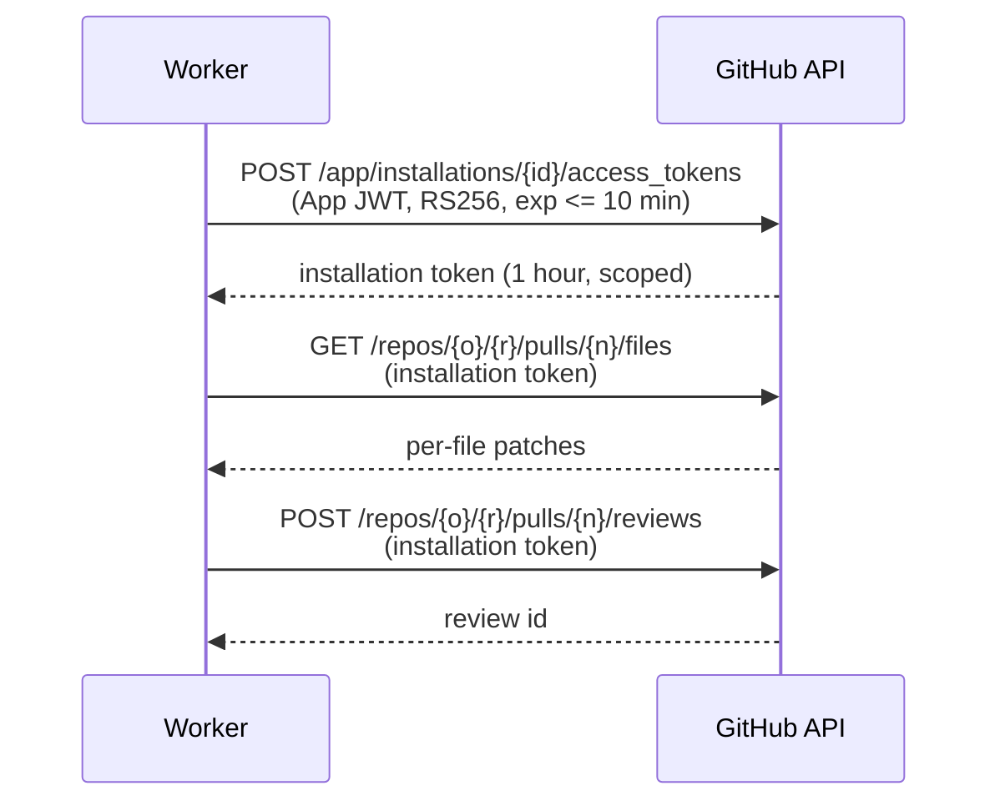

# GitHub integration (proposal)

> **Planning artifact.** No GitHub code exists yet. This document covers
> installation and authentication, webhook ingestion, rate limiting, and the diff
> position mapping that inline review publishing depends on.

## 1. GitHub App configuration

A GitHub App, not an OAuth App: installations give per-repository access with
short-lived tokens, and the app gets its own identity for review comments.

### Permissions (least privilege)

| Permission    | Level        | Why                                                         |
| ------------- | ------------ | ----------------------------------------------------------- |
| Metadata      | Read         | Mandatory for every app.                                    |
| Pull requests | Read & Write | Read the diff and PR metadata; publish the review.          |
| Contents      | Read         | Fetch surrounding file content for context beyond the hunk. |

Deliberately **not** requested for the MVP: `Checks: Write` (only needed if we
publish check runs), `Issues`, `Actions`, `Administration`, and anything granting
write access to code. The app must be incapable of changing a repository.

### Subscribed events

| Event                       | Actions used                                                             |
| --------------------------- | ------------------------------------------------------------------------ |
| `installation`              | `created`, `deleted`, `suspend`, `unsuspend`, `new_permissions_accepted` |
| `installation_repositories` | `added`, `removed`                                                       |
| `pull_request`              | `opened`, `synchronize`, `reopened`, `ready_for_review`, `closed`        |

`closed` is subscribed only to keep `PullRequest.state` accurate; it never
triggers a review. `issue_comment` and `pull_request_review_comment` are deferred
until slash-command re-reviews are in scope.

## 2. Authentication

Three distinct credentials, with different lifetimes and blast radii.



### App JWT

Signed with the app's RSA private key (RS256). `iss` is the App ID, `iat` is set
60 seconds in the past to tolerate clock skew, and `exp` is at most 10 minutes
ahead. Used exclusively for `/app/*` endpoints — never for repository data.

### Installation access token

`POST /app/installations/{installation_id}/access_tokens`, valid one hour. The
request body may narrow the token further, and we will use that: each job
requests a token scoped to the **single repository** it is about, via
`repository_ids`. A leaked token then affects one repository for under an hour
rather than the whole installation.

Caching: in-process `Map<installationId, { token, expiresAt }>` with refresh at
55 minutes. Tokens are **not** persisted. Each worker process holding its own
cache costs a few extra token mints, which is cheaper than owning an encrypted
token store and its rotation story.

### User access token (OAuth, user-to-server)

Used only at sign-in, for two calls:

1. `GET /user` — establish identity, upsert `GithubAccount` + `User`.
2. `GET /user/installations` — the installations this user may access, which
   populates `UserInstallation`.

The token is then **discarded**. It is never stored and never used to read
repository data; all repository access uses installation tokens. This is the
single biggest reduction in stored-secret surface available to us, and it works
because the dashboard reads from our own database rather than proxying GitHub.

The cost is staleness: if a user loses repository access on GitHub, our
`UserInstallation` rows do not know until their next sign-in. Mitigation is a
re-validation job on a schedule, which is deferred — recorded as an open
question in [§8](#8-open-questions).

### Secret handling

| Secret              | Source                            | Rule                                                        |
| ------------------- | --------------------------------- | ----------------------------------------------------------- |
| App private key     | `GITHUB_APP_PRIVATE_KEY` (base64) | Base64 so PEM newlines survive env transport. Never logged. |
| Webhook secret      | `GITHUB_WEBHOOK_SECRET`           | Compared with `crypto.timingSafeEqual` only.                |
| OAuth client secret | `GITHUB_OAUTH_CLIENT_SECRET`      | API process only; the web app never sees it.                |
| Installation tokens | Minted at runtime                 | Memory only, redacted from logs and error reports.          |

These names belong in `.env.example` with empty values and in `turbo.json`'s
`build.env` list, otherwise Turborepo will serve a cached build that was produced
with different configuration.

## 3. Webhook ingestion

### Required changes to existing code

Inspecting the current API turned up three concrete blockers. All are in
`apps/api/src/main.ts` and none have been changed:

1. **Raw body is unavailable.** `NestFactory.create(AppModule)` must become
   `NestFactory.create(AppModule, { rawBody: true })` so that `request.rawBody`
   exists. HMAC must be computed over the exact bytes GitHub signed; a
   re-serialised JSON object will not match.
2. **The global `ValidationPipe` would reject GitHub payloads.** It is configured
   with `forbidNonWhitelisted: true`, which rejects any property absent from the
   DTO — and GitHub payloads carry hundreds. The webhook route must take the raw
   request rather than a DTO, verify the signature, and then validate only the
   handful of fields it reads with a narrow schema.
3. **The default body size limit is too small.** Express defaults to 100 kB while
   GitHub payloads can reach 25 MB. The limit must be raised for the webhook
   route specifically, not globally.

### Flow

```
POST /api/v1/webhooks/github
  1. Read raw body                       (rawBody: true)
  2. Verify X-Hub-Signature-256          timing-safe; 401 on mismatch
  3. Parse envelope                      event, action, delivery id, ids
  4. BEGIN
       INSERT webhook_deliveries ... ON CONFLICT (delivery_id) DO NOTHING
       -- if no row was inserted, this is a replay: skip step 5
       INSERT jobs ...               ON CONFLICT (dedupe_key) DO NOTHING
     COMMIT
  5. 202 Accepted
```

No domain work happens in the request. GitHub gives a webhook endpoint about ten
seconds before it records a delivery failure, and an AI review takes far longer,
so the handler only ever records and enqueues.

### Idempotency

Three independent layers, because GitHub redelivers and clients retry:

1. **Delivery level.** `WebhookDelivery.deliveryId` is unique. A replayed
   delivery loses the insert and is acknowledged without creating work.
2. **Job level.** `Job.dedupeKey` is unique. Two `synchronize` events arriving
   for the same head commit collapse into one analysis.
3. **Review level.** `Review.dedupeKey` is unique. Even if a duplicate job
   escapes, it cannot produce a second review for the same commit.

### Stale head suppression

A force-push or a rapid second push makes an in-flight analysis worthless: its
findings reference line numbers in a commit that is no longer the PR head, and
GitHub would mark the comments outdated.

On `synchronize` with a new head SHA:

1. Cancel `PENDING` jobs for the same pull request whose payload carries an older
   SHA (`status = CANCELLED`).
2. Leave `RUNNING` jobs alone — they are mid-flight. Instead, the publish step
   re-reads the PR head and aborts if it has moved, marking the review `SKIPPED`
   with reason `stale_head`.

Aborting at publish time rather than mid-analysis is deliberate: the AI spend has
already happened, and the findings remain useful evidence for debugging even
though they are not published.

## 4. Rate limits

An installation token carries a baseline of 5,000 REST requests per hour, higher
for large organisations. GitHub additionally applies secondary limits on request
concurrency and on content-creating requests. Those secondary numbers are not
contractual, so the client reacts to them rather than modelling them.

A single `GithubApiClient` owns every outbound call and applies:

- **Header accounting.** Record `x-ratelimit-remaining` and `x-ratelimit-reset`
  per installation after each response.
- **Budget check before expensive work.** If remaining is below a floor, the job
  is rescheduled at `reset` instead of failing.
- **Backoff.** On `403`/`429`, honour `retry-after` when present, otherwise
  exponential backoff with full jitter, capped at the job's `maxAttempts`.
- **Per-installation serialisation.** Concurrency of one or two per installation,
  so one busy customer cannot exhaust its own budget in a burst.
- **Conditional requests.** `ETag`/`If-None-Match` on re-reads; a `304` does not
  consume quota.

The dominant saving is structural rather than tactical: the whole review is
published as **one** review object carrying all inline comments, instead of one
API call per comment. A 20-finding review costs one content-creating request, not
twenty.

## 5. Diff retrieval and the position map

This is the part that decides whether inline comments land or the API rejects the
review, so it is specified concretely.

### Retrieval

`GET /repos/{owner}/{repo}/pulls/{number}/files?per_page=100`, paginated. Chosen
over the raw `.diff` media type because it returns structured per-file entries —
`filename`, `previous_filename`, `status`, `additions`, `deletions`, `sha`, and a
`patch` string — which removes the need to split one giant unified diff.

Three cases must be handled explicitly, and each is a real source of bugs:

| Case                       | Signal                                         | Handling                                               |
| -------------------------- | ---------------------------------------------- | ------------------------------------------------------ |
| Binary file                | `patch` absent                                 | Skip; never commentable.                               |
| File too large for a patch | `patch` absent, `changes` large                | Skip the hunks; may still be mentioned in the summary. |
| Renamed file               | `status: renamed`, `previous_filename` present | Comment against the **new** `filename`.                |
| Deleted file               | `status: removed`                              | Only `LEFT` side is commentable.                       |

The file list is also capped by GitHub (3,000 files), so a very large PR is
inherently partial. That must be stated in the review summary rather than
silently ignored.

### Parsing a patch into a position map

GitHub's `patch` is a unified diff fragment with no `---`/`+++` header. Hunk
headers match `^@@ -(\d+)(?:,(\d+))? \+(\d+)(?:,(\d+))? @@`.

Walking the lines of a hunk while tracking two counters yields, for every diff
line, which sides may be commented on:

| Prefix | Meaning                     | Commentable as                       | Counters         |
| ------ | --------------------------- | ------------------------------------ | ---------------- |
| `' '`  | context                     | `LEFT: oldLine` and `RIGHT: newLine` | both advance     |
| `'+'`  | added                       | `RIGHT: newLine`                     | new advances     |
| `'-'`  | removed                     | `LEFT: oldLine`                      | old advances     |
| `'\'`  | "No newline at end of file" | nothing                              | neither advances |

The result, per pull request head commit:

```ts
type PositionMap = Map<
  string, // file path, always the post-rename name
  {
    right: Set<number>; // new-file lines that may carry a comment
    left: Set<number>; // old-file lines that may carry a comment
    hunks: { oldStart: number; oldLines: number; newStart: number; newLines: number }[];
  }
>;
```

Two details that are easy to get wrong:

- Context lines **are** part of the diff and are commentable. Restricting
  comments to added lines only would discard valid findings about code the PR
  touches but does not change.
- A hunk header with no count (`@@ -0,0 +1 @@`) means a count of one, not zero.

### Validating a finding against the map

Every finding passes this gate before it can be published:

1. `filePath` is a key in the map.
2. `side` is present for that file.
3. Every line in `[startLine, endLine]` is in the corresponding set.
4. The span is at most 20 lines, rejecting absurd ranges.
5. `fingerprint` has not already been seen in this review.
6. `severity` meets the repository's threshold.

Findings that fail 1–4 are stored with `status = UNMAPPABLE` and an
`unmappableReason`, then rendered as plain text in the review summary body. They
are neither dropped nor allowed to break the review: the unmappable rate becomes
a quality metric for the prompt.

Pre-validation is not optional. GitHub rejects the **entire** review with `422`
if a single comment references a line outside the diff, so one bad finding would
otherwise discard nineteen good ones.

## 6. Publishing the review

One request:

```http
POST /repos/{owner}/{repo}/pulls/{number}/reviews
```

```json
{
  "commit_id": "<head sha the analysis ran against>",
  "event": "COMMENT",
  "body": "<summary, including unmappable findings>",
  "comments": [
    { "path": "apps/api/src/health/health.service.ts", "line": 42, "side": "RIGHT", "body": "..." },
    {
      "path": "apps/web/src/lib/utils.ts",
      "start_line": 10,
      "start_side": "RIGHT",
      "line": 14,
      "side": "RIGHT",
      "body": "..."
    }
  ]
}
```

Decisions embedded in that payload:

- **`line` + `side`, never the legacy `position` field.** `position` is an offset
  into the diff text, which shifts whenever the patch changes and is miserable to
  compute and debug. `line` is a file line number, which is what a finding
  naturally carries.
- **`event` is always `COMMENT`.** The app never submits `APPROVE` or
  `REQUEST_CHANGES`. A reviewer driven by a language model reading untrusted
  input must not be able to gate a merge — see [security](./architecture.md#10-security-architecture).
- **`commit_id` is the SHA the analysis ran against**, re-checked immediately
  before posting.
- **Comment count is capped** (proposed: 15) and ordered by severity. The failure
  mode of an AI reviewer is noise, not silence.

`githubReviewId` and each `githubCommentId` are stored so a later phase can
update or resolve threads.

## 7. Failure modes

| Failure                           | Detection                 | Response                                                    |
| --------------------------------- | ------------------------- | ----------------------------------------------------------- |
| Invalid webhook signature         | HMAC mismatch             | `401`, no row written, no work queued.                      |
| Replayed delivery                 | Unique violation          | `202`, no work queued.                                      |
| Installation suspended or revoked | `401`/`403` on API call   | Mark `Installation.suspendedAt`, cancel its queued jobs.    |
| Permission downgraded             | `403` on a specific scope | Mark installation degraded; surface in the dashboard.       |
| Rate limit exhausted              | `403`/`429` + headers     | Reschedule the job at `x-ratelimit-reset`.                  |
| Head moved before publishing      | PR head re-read           | `SKIPPED` with reason `stale_head`.                         |
| Review rejected `422`             | Response status           | Log the offending comment set; republish summary-only.      |
| PR has no reviewable files        | Empty position map        | `SKIPPED` with reason `no_reviewable_changes`; no AI spend. |

## 8. Open questions

1. **Re-validating access.** `UserInstallation` is refreshed only at sign-in. Do
   we accept that staleness for the MVP, or add a periodic re-validation job?
2. **Which PRs to skip by default.** Drafts, bot authors such as Dependabot, and
   PRs above a size threshold all cost money for little value. Proposed defaults:
   skip drafts, skip bots, cap at 50 files — all three need a product decision.
3. **GitHub Enterprise Server.** Supporting it means a configurable API base URL
   and no reliance on `api.github.com`. Cheap now, expensive to retrofit.
4. **Check runs.** Publishing a check run alongside the review gives a visible
   pass/fail in the PR UI, but needs `Checks: Write` and raises the question of
   whether the bot can ever block a merge.
5. **Suggestion blocks.** GitHub renders a committable patch from a suggestion
   block in a comment body. High value, but it requires the finding's line range
   to align exactly with the replaced code, which raises the validation bar.
